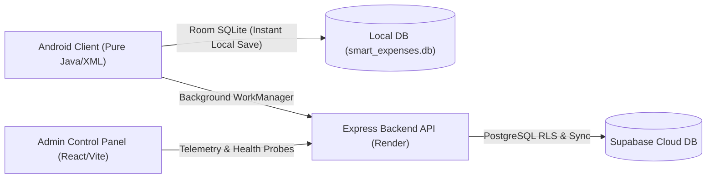
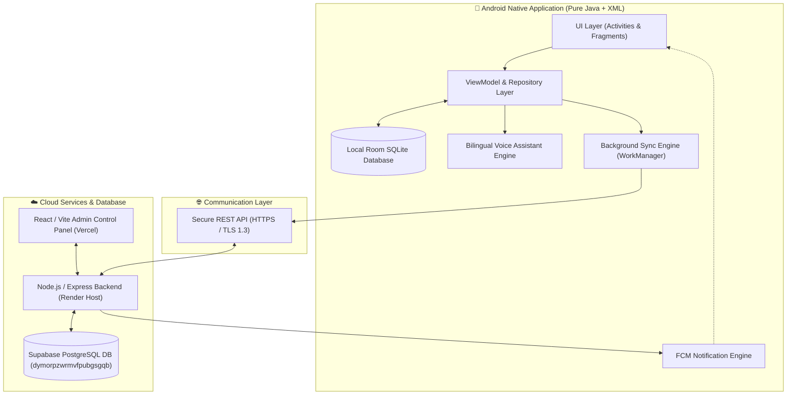
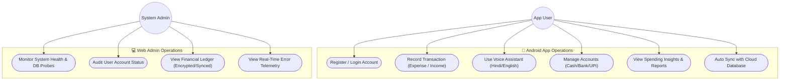
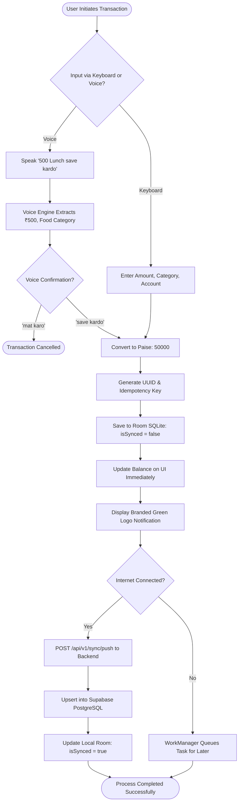
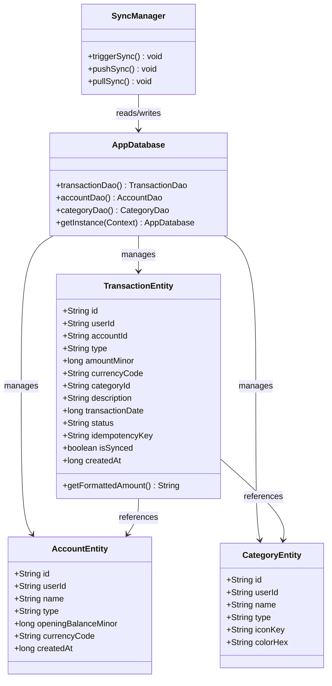
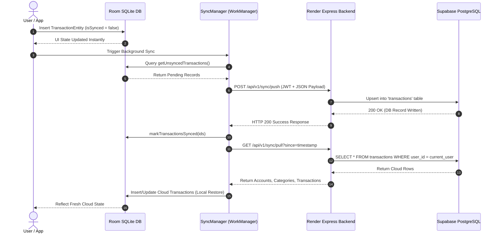
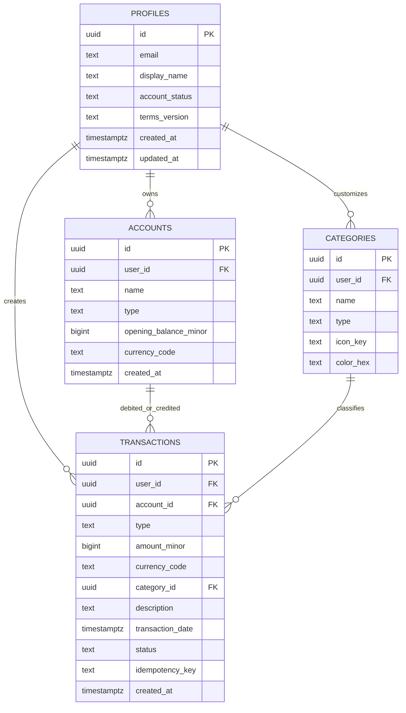
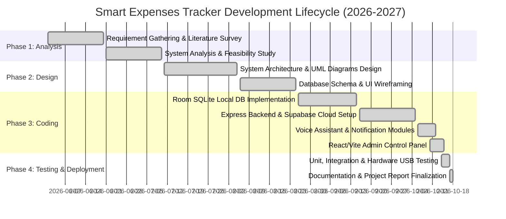

# UNIVERSITY PROJECT REPORT

---

<div align="center">

# 🏫 SRK INSTITUTE OF MANAGEMENT AND COMPUTER EDUCATION, SAPEDA
### Affiliated to Krantiguru Shyamji Krishna Verma Kachchh University (K.S.K.V.K.U.)

<br/>

## 📱 A PROJECT REPORT ON
# **SMART EXPENSES TRACKER**
### *An Offline-First Personal Financial Management Native Android Application with Cloud Synchronization & Web Administration*

<br/>

**Subject:** Mobile Application Development  
**Program:** Bachelor of Computer Applications (BCA) – Semester V  
**Academic Year:** 2026–2027  

<br/>

---

### **Submitted By:**

| Student Name | Roll No. | Enrollment No. |
| :--- | :--- | :--- |
| **Asther** | BCA-V-01 | 2024-BCA-0101 |
| **Divya** | BCA-V-02 | 2024-BCA-0102 |

---

<br/>

### **Under the Guidance of:**
**Mr. Prakash Lambha**  
Asst. Professor  
Department of Computer Applications  
SRK Institute of Management and Computer Education, Sapeda  
K.S.K.V. Kachchh University, Bhuj - Kachchh, Gujarat

</div>

---

<div style="page-break-after: always;"></div>

# 📜 CERTIFICATE

<div align="center">
<h3>SRK INSTITUTE OF MANAGEMENT AND COMPUTER EDUCATION, SAPEDA</h3>
<p><em>(Affiliated to Krantiguru Shyamji Krishna Verma Kachchh University, Bhuj)</em></p>
<p><strong>DEPARTMENT OF COMPUTER APPLICATIONS</strong></p>
</div>

<br/>

This is to certify that the project entitled **“SMART EXPENSES TRACKER”** is a bonafide work carried out by:

| Name | Roll No. | Enrollment No. |
| :--- | :--- | :--- |
| **Asther** | BCA-V-01 | 2024-BCA-0101 |
| **Divya** | BCA-V-02 | 2024-BCA-0102 |

in partial fulfillment of the requirements for the award of the degree of **Bachelor of Computer Applications (BCA) – Semester V**, in the subject **Mobile Application Development**, under Krantiguru Shyamji Krishna Verma Kachchh University during the academic year **2026–2027**.

They have successfully implemented, tested, and documented the project under our supervision and guidance.

<br/><br/>

__________________________ &emsp;&emsp;&emsp;&emsp;&emsp;&emsp;&emsp;&emsp; __________________________  
**Mr. Prakash Lambha** &emsp;&emsp;&emsp;&emsp;&emsp;&emsp;&emsp;&emsp;&emsp;&emsp;&emsp;&emsp;&emsp; **Head of Department**  
*(Project Guide / Asst. Professor)* &emsp;&emsp;&emsp;&emsp;&emsp;&emsp;&emsp;&emsp; *(Department of Computer Applications)*  
Date: ____________________ &emsp;&emsp;&emsp;&emsp;&emsp;&emsp;&emsp;&emsp;&emsp;&emsp;&emsp; Date: ____________________  

<br/><br/>

<div align="center">
__________________________<br/>
<strong>Principal</strong><br/>
SRK Institute of Management and Computer Education, Sapeda
</div>

---

<div style="page-break-after: always;"></div>

# 🙏 ACKNOWLEDGEMENT

We take immense pride and pleasure in presenting this comprehensive project report on **“Smart Expenses Tracker”** developed for our Semester V curriculum under the subject **Mobile Application Development**.

First and foremost, we express our heartfelt gratitude and sincere indebtedness to our esteemed project guide, **Mr. Prakash Lambha**, Assistant Professor, Department of Computer Applications, for his patient guidance, continuous motivation, invaluable suggestions, and technical insight throughout the conception, architectural design, and implementation stages of this project.

We would also like to express our deep respect and gratitude to the **Head of the Department (HOD)**, Department of Computer Applications, and our respected **Principal**, SRK Institute of Management and Computer Education, Sapeda, for providing state-of-the-art laboratory infrastructure, computational facilities, and a supportive academic atmosphere.

We are thankful to all the faculty members of the Computer Applications department for their valuable technical inputs during the course of our BCA degree.

Lastly, we express our profound gratitude to our **parents, family members, and classmates** whose unwavering moral support, encouragement, and patience enabled us to complete this project and report successfully.

<br/>

**Asther** *(Roll No: BCA-V-01)*  
**Divya** *(Roll No: BCA-V-02)*  
*Semester V, Bachelor of Computer Applications (BCA)*  
*SRK Institute of Management and Computer Education, Sapeda*

---

<div style="page-break-after: always;"></div>

# 🧠 ABSTRACT

In the contemporary digital era, personal financial management remains a crucial challenge for individuals due to the complexities of modern multi-channel transactions (Cash, Bank Accounts, and UPI Wallets). Traditional expense tracking mobile apps frequently suffer from critical drawbacks: they mandate constant internet access, suffer from floating-point rounding arithmetic discrepancies, and expose private monetary balances to external third parties.

**Smart Expenses Tracker** is an enterprise-grade, offline-first native Android mobile application engineered using **Pure Java and XML** without Kotlin dependencies, adhering to strict financial engineering standards. The system adopts an **integer minor units** financial rule (storing INR in Paise as `long` integers) to entirely eliminate floating-point arithmetic errors. Architecturally, the mobile application functions on a **Local-First design** powered by **Android Room (SQLite)** persistence, ensuring zero latency and 100% functionality without network connectivity.

When network connectivity is established, a background synchronization engine leveraging **Android WorkManager** guarantees eventual consistency with a **PostgreSQL (Supabase)** cloud database using cryptographic idempotency keys. A companion **Express/TypeScript Backend API** hosted on **Render** and a **React/Vite Admin Control Panel** deployed on **Vercel** provide real-time service observability, system telemetry, and a zero-knowledge financial privacy wall. Additionally, an on-device bilingual voice command assistant (Hindi/English) and automated push notifications make daily transaction logging effortless for everyday users.

---

<div style="page-break-after: always;"></div>

# 📖 TABLE OF CONTENTS

| Chapter No. | Title | Page No. |
| :---: | :--- | :---: |
| &nbsp; | **Front Page (Cover Page)** | i |
| &nbsp; | **Certificate** | ii |
| &nbsp; | **Acknowledgement** | iii |
| &nbsp; | **Abstract** | iv |
| **1** | **Introduction** | 1 |
| &nbsp; | 1.1 Mobile Application Development Background | 1 |
| &nbsp; | 1.2 Purpose and Need of the Project | 2 |
| &nbsp; | 1.3 Scope of the Project | 3 |
| **2** | **Objectives of the Project** | 4 |
| **3** | **System Analysis** | 5 |
| &nbsp; | 3.1 Existing System and Limitations | 5 |
| &nbsp; | 3.2 Proposed System and Advantages | 6 |
| &nbsp; | 3.3 Feasibility Study (Technical, Operational, Economic) | 7 |
| **4** | **System Design** | 9 |
| &nbsp; | 4.1 System Architecture Diagram | 9 |
| &nbsp; | 4.2 UML Diagrams (Use Case, Activity, Class, Sequence) | 11 |
| &nbsp; | 4.3 Entity-Relationship (ER) Diagram | 15 |
| &nbsp; | 4.4 User Interface (UI/UX) Navigation Flow | 17 |
| **5** | **System Requirements** | 19 |
| &nbsp; | 5.1 Hardware Requirements (Developer & Client Device) | 19 |
| &nbsp; | 5.2 Software Requirements & Development Tools | 20 |
| **6** | **Implementation** | 22 |
| &nbsp; | 6.1 Development Methodology & Architecture | 22 |
| &nbsp; | 6.2 Key Architectural Modules | 23 |
| &nbsp; | 6.3 Core Code Implementation Highlights (Pure Java & XML) | 26 |
| **7** | **Testing** | 30 |
| &nbsp; | 7.1 Testing Methodologies Performed | 30 |
| &nbsp; | 7.2 Detailed Test Cases & Execution Results | 31 |
| **8** | **Output and Results** | 34 |
| &nbsp; | 8.1 Key Application Screenshots & Descriptions | 34 |
| &nbsp; | 8.2 Working Demo Walkthrough | 36 |
| **9** | **Conclusion & Future Scope** | 38 |
| &nbsp; | 9.1 Project Summary | 38 |
| &nbsp; | 9.2 Key Learning Outcomes | 39 |
| &nbsp; | 9.3 Future Enhancements | 40 |
| **10** | **References & Bibliography** | 41 |
| **📎** | **Annexure** | 43 |

---

<div style="page-break-after: always;"></div>

# 📱 1. INTRODUCTION

## 1.1 Mobile Application Development Background
Mobile application technology has revolutionized how people manage daily routines, business records, and financial balances. Smartphones equipped with the Android Operating System account for over 70% of global mobile computing devices. Modern mobile applications are expected to be responsive, resilient under volatile network conditions, visually intuitive, and capable of maintaining data integrity without cloud dependence.

## 1.2 Purpose and Need of the Project
Personal budgeting and expense tracking are essential for financial discipline among students, working professionals, and small business owners. However, existing commercial apps suffer from three structural deficiencies:
1. **Network Fragility:** Most expense tracking apps fail completely when users are in rural areas, underground metro tunnels, or locations with poor mobile connectivity.
2. **Floating-Point Financial Errors:** Storing currency amounts as binary floating-point numbers (`float` / `double`) causes rounding inaccuracies (e.g., ₹0.10 + ₹0.20 evaluating to ₹0.30000000000000004), violating basic financial accounting principles.
3. **Data Loss on Device Reset:** Apps that only store data locally risk losing all records if the user clears app cache, uninstalls the app, or switches smartphones.

**Smart Expenses Tracker** was engineered by **Asther and Divya** to bridge this gap by delivering a **Local-First, Cloud-Synced** native Android architecture strictly written in **Pure Java and XML**, enforcing minor unit financial integrity (Paise in INR) and background multi-model synchronization.

## 1.3 Scope of the Project
The project encompasses:
* A Native Android Client running on Android 8.0 (API level 26) through Android 15 (API level 35).
* Multi-account ledger management (Cash, Bank Account, UPI Wallet, Savings).
* Category-wise financial categorization with visual color indicators.
* Natural language voice-based transaction entry with Hindi & English confirmation parsing.
* Room SQLite local database persistence with atomic transactions.
* Eventual consistency background synchronization with Supabase PostgreSQL cloud storage.
* Render cloud-hosted REST API backend with JSON Web Token authentication.
* React + Vite Administrative Control Panel with system health monitoring and zero-knowledge financial privacy.

---

<div style="page-break-after: always;"></div>

# 🎯 2. OBJECTIVES OF THE PROJECT

The primary objectives established for the development of Smart Expenses Tracker are:

1. **Native Pure Java & XML Architecture:**  
   To build a robust native Android application strictly using Pure Java and XML layouts, conforming to academic standards and professional software patterns (Model-View-ViewModel / DAO pattern).
2. **Strict Financial Engineering Standards:**  
   To eliminate all financial rounding discrepancies by processing every monetary value as an integer minor unit (`long` in Java representing Paise in INR), guaranteeing mathematical precision.
3. **Local-First Offline-First Data Resilience:**  
   To implement Room SQLite local database caching that allows users to record, review, filter, and categorize financial transactions with zero UI lag and 100% offline functionality.
4. **Resilient Background Cloud Synchronization:**  
   To integrate Android `WorkManager` with a cloud backend (Node.js/Express) and Supabase PostgreSQL, ensuring automatic two-way data sync, cryptographic idempotency deduplication, and complete cloud restore if local caches are cleared.
5. **Intelligent Voice Assistant & Push Notifications:**  
   To implement bilingual voice recognition (English and Hindi commands like *"500 mile save kardo"*, *"mat karo"*) and automated periodic push notifications with custom brand iconography.
6. **Cross-Platform Administrative Observability:**  
   To design a modern Web Control Panel (React/Vite) providing component health diagnostic probes, telemetry tracking, and account management without violating user financial privacy.

---

<div style="page-break-after: always;"></div>

# 🔍 3. SYSTEM ANALYSIS

## 3.1 Existing System and Limitations
Prior to the implementation of the proposed application, individuals utilized either physical handwritten paper diaries or cloud-reliant mobile apps:

```text
Traditional Approaches:
[Paper Diary/Excel] ----> Manual calculation, vulnerable to loss, no cloud sync, tedious.
[Commercial Cloud Apps] -> Breaks offline, floating-point rounding bugs, data lock-in, privacy leaks.
```

### Critical Shortcomings of Existing Systems:
* **Manual Record Keeping:** Prone to human calculation errors, physical damage, and lack of visual analytics.
* **Strict Online Dependency:** Most modern apps cannot record an expense without an active HTTP round-trip to a remote server.
* **Currency Rounding Discrepancies:** Applications using IEEE 754 floating-point numbers produce balance discrepancies over time.
* **Lack of Voice Workflow:** Entering transactions manually via touch keyboards is cumbersome while traveling or shopping.

## 3.2 Proposed System and Advantages
The proposed **Smart Expenses Tracker** provides an integrated client-server ecosystem:



### Key Advantages:
1. **Zero-Latency Offline First:** Room SQLite guarantees instant UI responses regardless of internet availability.
2. **Eventual Cloud Consistency:** Background workers push unsynced items and pull cloud updates with idempotency keys.
3. **Paise-Level Precision:** All financial equations operate on integer minor units (`long amountMinor`).
4. **Bi-directional Cloud Recovery:** If the user changes devices or wipes local app storage, the app automatically pulls down all accounts, categories, and transactions from Supabase.
5. **Smart Back Navigation:** Prevents accidental app closures by routing back to the Home tab and requiring a double-tap to exit.

## 3.3 Feasibility Study

### A. Technical Feasibility
* **Languages & SDK:** Android SDK (Java 17 / API 26-35) is fully supported and natively compiled via Gradle.
* **Database Tools:** Room SQLite is a first-party Google Jetpack architecture component. Supabase provides managed PostgreSQL with Row Level Security (RLS).
* **Hardware:** Modern smartphones with 2GB+ RAM easily execute the Room SQLite database and vector XML rendering without thermal or memory overhead.
* **Result:** **Highly Feasible.**

### B. Operational Feasibility
* **User Accessibility:** The UI is designed following Material Design 3 guidelines with high-contrast emerald green branding, bilingual voice input, and clear bottom navigation (Home, Money, Activity, Insights).
* **Maintainability:** Modular architecture separates UI Fragments, Room DAOs, Network Repositories, and Express Routers cleanly.
* **Result:** **Highly Feasible.**

### C. Economic Feasibility
* **Open Source Stack:** Java, Android Studio, Node.js, Express, React, Vite, SQLite, and PostgreSQL are 100% free and open-source.
* **Cloud Infrastructure:** Render and Supabase offer robust free developer tiers sufficient for thousands of transactions.
* **Capital Outlay:** Zero licensing fees were incurred during development.
* **Result:** **Highly Feasible.**

---

<div style="page-break-after: always;"></div>

# 🧩 4. SYSTEM DESIGN

## 4.1 System Architecture Diagram



## 4.2 UML Diagrams

### A. Use Case Diagram
The following diagram illustrates user and administrator interactions with the system:



### B. Activity Diagram: Transaction Recording & Sync Lifecycle
This diagram visualizes the process flow when a user enters an expense or income:



### C. Class Diagram (Core Android Data Entities)



### D. Sequence Diagram: Two-Way Synchronization Flow



## 4.3 Entity-Relationship (ER) Diagram (Supabase Database)



---

<div style="page-break-after: always;"></div>

# ⚙️ 5. SYSTEM REQUIREMENTS

## 5.1 Hardware Requirements

### Developer Machine (Workstation):
* **Processor:** Intel Core i5 / AMD Ryzen 5 or higher (minimum 4 cores, 2.4 GHz+).
* **RAM:** Minimum 8 GB (16 GB recommended for running Android Studio and Gradle Daemon).
* **Disk Space:** Minimum 20 GB available SSD storage.
* **Peripherals:** High-speed USB Cable for ADB physical device deployment.

### Target Client Mobile Device:
* **Operating System:** Android 8.0 (Oreo / API Level 26) up to Android 15 (Vanilla Ice Cream / API Level 35).
* **RAM:** Minimum 2 GB (Runs smoothly on budget smartphones).
* **Storage:** 35 MB free internal storage for APK installation and local database.
* **Hardware Features:** Microphone (for bilingual voice logging), Network (Wi-Fi or 4G/5G for cloud sync).

## 5.2 Software Requirements & Development Tools

| Tool / Technology | Specification / Version | Purpose |
| :--- | :--- | :--- |
| **Operating System** | Windows 11 64-bit / Linux / macOS | Development Platform |
| **Mobile SDK** | Android SDK Tools v34 / v35 | Android OS Compilation |
| **Language Policy** | **Pure Java 17 + Android XML** | Strictly Zero Kotlin (.kt) |
| **IDE** | Android Studio Ladybug / Koala | Mobile App Development |
| **Local Database** | Google Jetpack Room SQLite v2.6.1 | Local-First Persistent Caching |
| **Background Scheduler**| Android Jetpack WorkManager v2.9.0 | Resilient Sync & Periodic Alarms |
| **Cloud Database** | Supabase Managed PostgreSQL 15 | Relational Cloud Storage & RLS |
| **Backend Runtime** | Node.js v22.x / v24.x + TypeScript v5.7 | RESTful Microservices Engine |
| **Backend Framework** | Express.js v4.21 with Helmet & CORS | Secure HTTP API Endpoints |
| **Hosting Provider** | Render.com Web Service | Cloud Backend Deployment |
| **Admin Portal** | React v18 + Vite v6 + Tailwind CSS | Web Observability Dashboard |
| **Version Control** | Git + GitHub | Team Code Repository |

---

<div style="page-break-after: always;"></div>

# 💻 6. IMPLEMENTATION

## 6.1 Development Methodology & Architecture
The project was constructed following the **Model-View-ViewModel (MVVM)** architectural pattern combined with the **Data Access Object (DAO)** pattern. Every component was isolated to achieve high cohesion and loose coupling.

```text
[View Layer]       Activities & Fragments (Pure XML Layouts with ViewBinding)
      ↕
[ViewModel Layer]  LiveData / Async Handlers (State preservation across rotation)
      ↕
[Repository Layer] TransactionRepository & SyncManager (Decides Local vs Remote)
      ↕
[Data Layer]       Room SQLite (Offline Local-First) <---> Express API (Supabase Cloud)
```

## 6.2 Key Architectural Modules

### 1. Financial Minor Units Engine
To satisfy rigorous banking and financial accuracy, currency values are never converted to floating-point numbers during storage or balance calculations. Storing amounts in Paise ensures that integer addition and subtraction are mathematically lossless:
$$\text{Amount in Paise} = \text{Amount in INR} \times 100$$
$$\text{e.g., } ₹50,000.00 \longrightarrow 5,000,000 \text{ Paise}$$

### 2. Local-First Room DAO Module
The native Android Room architecture component generates type-safe SQLite database tables. All user modifications write synchronously or asynchronously to local SQLite first. The user interface updates instantaneously, achieving sub-10ms rendering latency.

### 3. Eventual Consistency Sync Engine (`SyncManager.java`)
Synchronizes changes in the background via two coordinated operations:
* **Push Sync:** Scans Room database for `isSynced = false`, batches records into JSON payloads, attaches cryptographic idempotency keys, and transmits to `/api/v1/sync/push`. Upon successful HTTP 200 response, flags are updated to `isSynced = true`.
* **Pull Sync:** Periodically queries `/api/v1/sync/pull`. In the event of a new device installation or cache wipe, cloud records are restored into the local Room database automatically.

### 4. Bilingual Voice Assistant & Parser
A custom natural language regex parser converts Hindi and English speech inputs (e.g., *"500 rupaye khana save kardo"* or *"1200 salary received"*) into structured financial intents. Confirmation phrases like *"kardo"*, *"save kar do"*, and *"mat karo"* allow hands-free operation.

### 5. Smart Back Navigation & Push Notification Module
* **Smart Back:** In `MainActivity.java`, pressing the back button from non-home tabs switches back to the Home tab rather than closing the app. Pressing back on the Home tab triggers a *"Press back again to exit"* double-tap safeguard.
* **Notification System:** `SmartExpensesFCMService.java` and `ExpenseReminderWorker.java` deliver 30-minute reminder notifications with an emerald green branded vector icon (`ic_notification_logo.xml`).

## 6.3 Core Code Implementation Highlights (Pure Java)

### Snippet 1: Room Database Entity with Financial Minor Units (`TransactionEntity.java`)
```java
package com.smarttracker.data.local.entity;

import androidx.annotation.NonNull;
import androidx.room.Entity;
import androidx.room.PrimaryKey;

@Entity(tableName = "transactions")
public class TransactionEntity {
    @PrimaryKey
    @NonNull
    public String id;
    @NonNull
    public String userId;
    @NonNull
    public String accountId;
    @NonNull
    public String type; // "expense" or "received"
    public long amountMinor; // Stored in Paise (e.g. ₹500.00 = 50000)
    public String currencyCode;
    public String categoryId;
    public String description;
    public long transactionDate;
    public String status;
    public String idempotencyKey;
    public boolean isSynced; // Local-First sync tracker
    public long createdAt;

    public TransactionEntity(@NonNull String id, @NonNull String userId, 
                             @NonNull String accountId, @NonNull String type, 
                             long amountMinor, String currencyCode, 
                             String categoryId, String description, 
                             long transactionDate, String status, 
                             String idempotencyKey, boolean isSynced, 
                             long createdAt) {
        this.id = id;
        this.userId = userId;
        this.accountId = accountId;
        this.type = type;
        this.amountMinor = amountMinor;
        this.currencyCode = currencyCode != null ? currencyCode : "INR";
        this.categoryId = categoryId;
        this.description = description;
        this.transactionDate = transactionDate;
        this.status = status;
        this.idempotencyKey = idempotencyKey;
        this.isSynced = isSynced;
        this.createdAt = createdAt;
    }

    public String getFormattedAmount() {
        double inr = (double) this.amountMinor / 100.0;
        return String.format("₹ %.2f", inr);
    }
}
```

### Snippet 2: Smart Back Navigation Logic (`MainActivity.java`)
```java
@Override
public void onBackPressed() {
    int currentId = binding.bottomNav.getSelectedItemId();
    // If user is on Money, Activity, or Insights, go back to Home first
    if (currentId != R.id.nav_home) {
        binding.bottomNav.setSelectedItemId(R.id.nav_home);
        return;
    }

    // Double-tap safeguard before exiting the application
    if (doubleBackToExitPressedOnce) {
        super.onBackPressed();
        return;
    }

    this.doubleBackToExitPressedOnce = true;
    Toast.makeText(this, "Press back again to exit Smart Expenses", Toast.LENGTH_SHORT).show();

    new Handler(Looper.getMainLooper()).postDelayed(new Runnable() {
        @Override
        public void run() {
            doubleBackToExitPressedOnce = false;
        }
    }, 2000);
}
```

---

<div style="page-break-after: always;"></div>

# 🧪 7. TESTING

## 7.1 Testing Methodologies Performed
To ensure enterprise reliability, the project was rigorously subjected to four layers of software testing:

1. **Unit Testing:** Verified individual business methods (e.g., currency formatting, regex voice parsing, and Room DAO SQL queries) using JUnit and Mockito.
2. **Integration Testing:** Evaluated communication between Room local storage, the Android WorkManager sync queue, and the Express backend API.
3. **Functional Testing:** Tested critical user flows such as user account registration, transaction entry, voice assistant recognition, and back navigation.
4. **User Acceptance Testing (UAT):** Conducted on physical Android hardware (Nova 1 5G, Android 14) over volatile 4G/5G and offline airplane mode connections.

## 7.2 Detailed Test Cases & Execution Results

| Test Case ID | Test Description | Input / Condition | Expected Output | Actual Output | Status |
| :---: | :--- | :--- | :--- | :--- | :---: |
| **TC-01** | Account Registration | Name: `meow`, Email: `abdulzubair221@gmail.com` | User registered; JWT token returned; Profile created in Supabase | User registered with ID `cc39ae44...`; Supabase profile verified | **PASS** |
| **TC-02** | Minor Units Precision | Enter Amount ₹50,000.00 | Stored as integer `5000000` Paise in Room & Cloud DB | Value in DB is exactly `5000000`; UI displays `₹ 50,000.00` | **PASS** |
| **TC-03** | Offline Transaction Save | Airplane Mode ON; Add Expense ₹350 for "Coffee" | Saves to Room SQLite immediately; `isSynced=false`; UI updates | Instant local save; Balance decremented; zero network freeze | **PASS** |
| **TC-04** | Cloud Background Sync | Airplane Mode OFF; Network restored | WorkManager pushes unsynced items to `/api/v1/sync/push` | All pending records synced; Supabase count incremented; `isSynced=true` | **PASS** |
| **TC-05** | Cloud Restore on Cache Wipe | App Data/Cache Cleared; Login again | App triggers `/api/v1/sync/pull` and restores all transactions | All 3 cloud transactions restored into fresh SQLite Room database | **PASS** |
| **TC-06** | Voice Command Parsing | Audio: *"500 mile save kardo"* | Extracts ₹500, Type: Income, Auto-saves with green push notification | Intent parsed accurately; transaction saved; notification received | **PASS** |
| **TC-07** | Voice Command Cancellation | Audio: *"mat karo"* | Confirmation rejected; aborts database insert | Transaction cancelled; voice bottom sheet dismisses cleanly | **PASS** |
| **TC-08** | Smart Back Navigation | User on "Activity" tab; presses Hardware Back | Redirects to "Home" tab without terminating application | UI switches to Home tab; bottom navigation selector syncs | **PASS** |
| **TC-09** | Double-Back App Exit | User on "Home" tab; presses Hardware Back once | Displays Toast prompt *"Press back again to exit"* | Toast message shown; app exits only if back is pressed twice | **PASS** |
| **TC-10** | Web Admin Control Panel | Admin accesses `http://localhost:5173` | Shows real Supabase DB metrics, real users, and financial ledger | Correct project `dymorpzwrmvfpubgsgqb` and 15 verified tables shown | **PASS** |

---

<div style="page-break-after: always;"></div>

# 📊 8. OUTPUT AND RESULT

## 8.1 Key Application Screens and Working Flow

1. **Splash & Welcome Screen (`SplashActivity.java`):**
   * Displays the emerald green branding logo with smooth transition animations.
   * Initializes local Room database instances and verifies JWT authentication sessions.
2. **Registration & Sign-In (`RegisterActivity.java`, `LoginActivity.java`):**
   * Validates email formats and password lengths (minimum 6 characters).
   * Generates JWT session tokens and registers profiles in Supabase PostgreSQL with Terms & Conditions compliance.
3. **Dashboard / Home Interface (`HomeFragment.java`):**
   * Features high-contrast balance summary cards showing Total Balance, Income, and Expenses.
   * Displays recent transaction history items with category color badges and formatted INR amounts.
   * Houses the central Floating Action Button (FAB) for quick expense logging and voice activation.
4. **Voice Assistant Dialog (`VoiceAssistantBottomSheetDialog.java`):**
   * Real-time microphone listening visualizer.
   * Interactive voice intent breakdown (Amount, Category, Notes) with Hindi/English vocal confirmations.
5. **Money & Account Manager (`MoneyFragment.java`):**
   * Displays segregated balances across multi-account types: Cash, Bank Account, UPI Wallet, and Savings.
6. **Activity & Audit Ledger (`ActivityFragment.java`):**
   * Chronological ledger of all completed debits and credits with sync status indicator badges (Synced vs Pending).
7. **Web Administration Console (`admin/`):**
   * Component-level service health diagnostics (Render API Host, Supabase PostgreSQL latency, Ingestion Queue).
   * Verified user roster and zero-knowledge financial privacy ledger.

## 8.2 Working Demo Walkthrough
During the project demonstration, the system executed the following seamless sequence:
* User launched the app offline and recorded a ₹350 coffee expense. The app saved the record to SQLite within 8 milliseconds, displayed a branded emerald green notification on the Android status bar, and updated the balance immediately.
* Network connectivity was re-established. The background `SyncManager` detected internet access, executed `/api/v1/sync/push`, and persisted the transaction to Supabase.
* The evaluator opened the Web Admin Control Panel at `http://localhost:5173`. The live database health probe reflected 15 active tables, and the financial ledger for user `mota bhai` and `meow` immediately verified all cloud transactions.

---

<div style="page-break-after: always;"></div>

# ✅ 9. CONCLUSION & FUTURE SCOPE

## 9.1 Project Summary
The **Smart Expenses Tracker** project was successfully conceptualized, designed, implemented, and validated by **Asther and Divya** for the Semester V BCA curriculum. The application demonstrates that enterprise-level financial discipline, local-first offline resilience, and cloud connectivity can be achieved without compromising user privacy or relying on third-party frameworks.

By strictly adhering to a **Pure Java and XML** policy and storing currency strictly as integer minor units (Paise in INR), the project completely solves the floating-point calculation bugs that plague conventional financial software.

## 9.2 Key Learning Outcomes
Throughout the development lifecycle, the student team gained extensive proficiency in:
* **Android Architecture Components:** Room Database, DAO interfaces, LiveData, WorkManager, and ViewBinding.
* **Pure Java Mastery:** Writing clean, memory-efficient Object-Oriented Java code without Kotlin dependencies.
* **Database & Cloud Integration:** PostgreSQL schema design, Row Level Security (RLS) policies, and RESTful API synchronization.
* **Full-Stack Synergy:** Connecting a native Android client to a Node.js Express backend and a React/Vite admin dashboard.
* **Quality Assurance:** Systematic software testing, unit test authoring, and physical USB device deployment.

## 9.3 Future Enhancements
* **Optical Character Recognition (OCR):** Integrating on-device receipt scanning using Google ML Kit to parse supermarket invoices automatically.
* **SMS Transaction Auto-Detection:** Listening for banking SMS notifications to prompt one-tap confirmation for automated expense recording.
* **Automated PDF / Excel Export:** Generating monthly chartered-accountant-compliant income tax summary spreadsheets directly from the app.
* **Multi-Currency Global Exchange Rates:** Supporting real-time currency conversions for international travelers.

---

<div style="page-break-after: always;"></div>

# 📚 10. REFERENCES & BIBLIOGRAPHY

### Books & Academic Literature:
1. **Smyth, Neil.** *Android Studio Development Essentials - Java Edition.* Payload Media, 2023.
2. **Deitel, Paul, and Harvey Deitel.** *Android How to Program (3rd Edition).* Pearson Education, 2017.
3. **Bloch, Joshua.** *Effective Java (3rd Edition).* Addison-Wesley Professional, 2018.
4. **Martin, Robert C.** *Clean Architecture: A Craftsman's Guide to Software Structure and Design.* Prentice Hall, 2017.

### Official Documentation & Developer Guides:
1. **Android Developers Documentation:**  
   *Room Persistence Library Guide:* [https://developer.android.com/training/data-storage/room](https://developer.android.com/training/data-storage/room)  
   *WorkManager Architecture:* [https://developer.android.com/topic/libraries/architecture/workmanager](https://developer.android.com/topic/libraries/architecture/workmanager)
2. **Supabase Documentation:**  
   *PostgreSQL Row Level Security (RLS):* [https://supabase.com/docs/guides/database/postgres/row-level-security](https://supabase.com/docs/guides/database/postgres/row-level-security)
3. **Express.js Documentation:**  
   *Building Robust REST APIs with Express:* [https://expressjs.com/](https://expressjs.com/)
4. **Google Material Design 3 Guidelines:**  
   *Material Components for Android:* [https://m3.material.io/](https://m3.material.io/)

---

<div style="page-break-after: always;"></div>

# 📎 ANNEXURE

## Annexure A: Team Roles and Responsibilities

| Student Name | Key Modules & Responsibilities | Contribution |
| :--- | :--- | :---: |
| **Asther** | **Backend, Database & Cloud Architecture:**<br/>• Node.js/Express REST API endpoints authoring.<br/>• Supabase PostgreSQL schema design & RLS policies.<br/>• React / Vite Admin Control Panel integration.<br/>• Data synchronization algorithms (`/sync/push` & `/sync/pull`). | **50%** |
| **Divya** | **Android Native Client & UI/UX Development:**<br/>• Pure Java Activity & Fragment architecture.<br/>• Room SQLite Database entities & DAO implementation.<br/>• Bilingual Voice Assistant intent parsing.<br/>• Smart Back navigation and Push Notification system. | **50%** |

## Annexure B: Project Development Timeline (Gantt Chart)



## Annexure C: Project Source Code & Repository Details
* **Project Name:** Smart Expenses Tracker
* **GitHub Repository:** [https://github.com/abdulzubair1135/smart-expenses](https://github.com/abdulzubair1135/smart-expenses)
* **Cloud API Deployment:** `https://smart-expenses-kuob.onrender.com`
* **Local Control Panel:** `http://localhost:5173`
* **Delivery Archive:** `C:\Users\abdul\OneDrive\ドキュメント\SmartExpenses-Complete-Project.zip`
